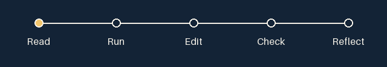

# 3. React: describe the next interface

Draft lesson · course version 0.1.0.


Read → run → edit → check → reflect, at your own pace.

<details>
<summary>Optional route animation (decorative)</summary>



This optional decoration plays once for 2.4 seconds. GitHub cannot apply your operating system’s reduced-motion preference to this GIF. It may finish while collapsed. The static diagram and text above contain the full meaning; no animation is needed.

</details>

## Objectives

- Separate a component's input, state, event, and rendered output.
- Compute a next state without modifying the previous one.
- Connect a labeled form control to an observable UI change.

## Prerequisites

Complete [JavaScript and TypeScript](javascript-typescript.md). Understand functions
and immutable array changes. Browser extensions or a public account are unnecessary.

## Effort

40–60 minutes. The checkpoint needs Node.js 24 LTS. The browser extension requires
an existing React/Next.js App Router project with dependencies installed according
to its own README; JSX does not execute in a standalone Node file.

## Concept

A component describes UI for given inputs. Props carry input from a parent; state
remembers information across renders. An event requests a state update; React
then renders a new description. Calling a state setter does not replace the value
inside the already-running event handler. Derive a next value from the previous
value when an update depends on it.

Our checkpoint tests the transition logic without a browser. It cannot prove that
a button works, so the browser extension supplies a separate manual check.

```tsx
'use client';
import { useState } from 'react';
export default function PracticeCounter() {
  const [count, setCount] = useState(0);
  return <section aria-labelledby="practice-title">
    <h2 id="practice-title">Practice notes</h2>
    <p aria-live="polite">Saved notes: {count}</p>
    <button onClick={() => setCount((previous) => previous + 1)}>Save a note</button>
  </section>;
}
```

Place this in `app/practice-counter.tsx`, import it into `app/page.tsx`, and render
`<PracticeCounter />`. It demonstrates temporary UI state only; refreshing resets it.

## Runnable checkpoint

Save as `checkpoint.mjs` and run `node checkpoint.mjs`.

```js
import assert from 'node:assert/strict';
function updateCount(previous, event) {
  if (!Number.isInteger(previous) || previous < 0) throw new TypeError('Invalid count');
  if (event === 'save') return previous + 1;
  if (event === 'reset') return 0;
  return previous;
}
const previous = 0;
assert.equal(updateCount(previous, 'save'), 1);
assert.equal(updateCount(updateCount(0, 'save'), 'save'), 2);
assert.equal(updateCount(3, 'reset'), 0);
assert.equal(updateCount(2, 'unknown'), 2);
assert.equal(previous, 0);
console.log('Checkpoint passed');
```

## Exercise

1. Add an `undo` event. Write tests before implementation: three becomes two;
   zero stays zero. Negative counts must never appear.
2. Add a labeled text input to the browser component. Store the draft title with
   `useState('')`; connect `value` and `onChange`.
3. Save through a form `onSubmit`, prevent the default navigation, and increment
   only when the trimmed title is nonempty. Clear the title after a successful save.
4. Keep count updates functional: `setCount((previous) => previous + 1)`.

Reset: restore the original checkpoint and component snippets. Keep a copy of your
work if useful. No server data exists to restore in this example.

## Hints

<details>
<summary>Hint 1: state transition</summary>

An undo transition can use `Math.max(0, previous - 1)`. It should return a value
rather than alter a separate variable.

</details>

<details>
<summary>Hint 2: form access</summary>

Pair `<label htmlFor="title">Note title</label>` with an input whose `id` is
`title`. A submit button inside the form lets Enter and a click share one handler.

</details>

## Validation

Run the Node assertions. In the browser use Tab to reach the input, type a title,
press Enter, and check that the count increases once and the field clears. Submit
spaces and verify no increase. Refresh and explain why the count resets. A passing
transition test alone does not verify event wiring, focus behavior, or persistence.

## Common mistakes

- Using a plain local variable for remembered UI data: it does not request a render.
- Changing an array or object in place and expecting clear state history.
- Calling the handler while rendering (`onClick={save()}`) instead of passing it.

## Accessibility

Give every input a visible label; use native buttons and a polite status message.
Avoid moving focus after every save or relying on placeholder text as the label.

## Reflection

Which values belong in state? Which can be calculated during render? What evidence
would distinguish a working transition function from a working interactive form?

## References

- React team, [State: A Component's Memory](https://react.dev/learn/state-a-components-memory), official reference, accessed 2026-10-16.
- See [source and rights records](../references.md).
