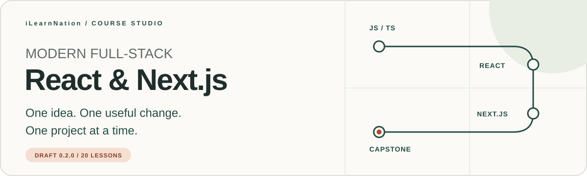

# Full-Stack Modern React and Next.js Application Development



**Learn the idea. Change the code. Explain what happened.**

An iLearnNation course for mixed self-directed learners. You do not need a CSE
degree to begin: check the prerequisites, choose one manageable goal, and practice
at your own pace. The destination is a project you understand well enough to test,
debug, and explain.

[Start here](getting-started.md) · [First checkpoint](chapters/foundations.md) ·
[Chapter roadmap](#your-chapter-roadmap) · [References](references.md) ·
[Support the course](#help-the-next-learner-find-their-way)

> [!NOTE]
> **Original draft 0.2.0.** Twenty complete lesson loops, trusted dependency-free
> JavaScript checkpoints, and bounded online scenario activities are available.
> The platform requires an account to submit checks and save progress. The exercises
> verify synthetic cases; full framework implementations and deployment require
> separate project evidence. Human curriculum review remains required before publication.

## Your first ten minutes

Begin with **[getting-started.md](getting-started.md)**. Understand the course goal,
check the proposed prerequisites, find your place in the roadmap, and write one
sentence about something you want to learn. Orientation comes before installation.
Ten minutes is an estimate, not a deadline.

The proposed starting knowledge is basic HTML/CSS, JavaScript variables and
functions, and navigating an editor and terminal. If a topic is unfamiliar, use
the preparation tasks rather than rushing past it. Your learning goal and reflection
notes can stay private; no public profile, fork, or progress post is required.

## The practice loop

**Read → Run → Change → Check → Reflect → Build**

Every chapter supplies objectives, prerequisites, estimated effort, a focused
explanation, a runnable checkpoint, exercises, progressive hints, reset instructions,
validation, common mistakes, accessibility notes, reflection, and references.

Try the checkpoint before revealing a hint. Change one thing and observe the
result. Read an error as feedback about the program, then explain your fix in your
own words. Carry the idea into the chapter's framework extension or capstone.

## Your chapter roadmap

| Step | Chapter | Practice focus |
| --- | --- | --- |
| 01 | [Foundations: make one observable change](chapters/foundations.md) | Orientation, environment checks, browser/server distinctions, and the first component learning loop. |
| 02 | [JavaScript data and TypeScript contracts](chapters/javascript-typescript.md) | Immutable transformations, static types, and runtime checks with meaningful edge cases. |
| 03 | [React: describe the next interface](chapters/react-components.md) | Props, state, transitions, events, and a labeled form practice extension. |
| 04 | [Node.js and document data](chapters/node-and-data.md) | Model asynchronous server work, owner-scoped document queries, projection, and storage lifetimes. |
| 05 | [APIs: make a small HTTP contract](chapters/api-contracts.md) | Validate a note creation endpoint and test status codes without opening a network port. |
| 06 | [Asynchronous data and request races](chapters/async-data.md) | Keep server-state cache identity, out-of-order responses, retries, and refresh failures understandable. |
| 07 | [Data, validation, persistence, and identity](chapters/data-and-forms.md) | Validate before writes, scope ownership to trusted identity, and state storage guarantees honestly. |
| 08 | [Identity, sessions, and access](chapters/identity-and-access.md) | Trace trusted identity into authorization and reason about cookies, expiry, and forged requests. |
| 09 | [Rendering and meaningful discovery](chapters/rendering-and-seo.md) | Compare server and client rendering, useful initial HTML, metadata, canonical URLs, and private routes. |
| 10 | [Quality: prove behavior and include people](chapters/quality-accessibility-security.md) | Behavior tests, keyboard and form review, safe URL policies, and the limits of automated evidence. |
| 11 | [Learning insights without surveillance](chapters/learning-insights.md) | Aggregate minimal consented events, deduplicate delivery, and explain small-group suppression. |
| 12 | [GraphQL: a bounded server contract](chapters/graphql-api.md) | Select public fields, validate query depth, and authorize each synthetic resolver. |
| 13 | [GraphQL: client state and mutations](chapters/graphql-client.md) | Model normalized identity, optimistic updates, duplicate confirmations, and targeted rollback. |
| 14 | [Realtime: authenticated server events](chapters/realtime-server.md) | Check connection identity, room membership, payload limits, storage failure, and acknowledgement order. |
| 15 | [Realtime: reconnect and reconcile](chapters/realtime-client.md) | Bound offline queues, preserve client IDs across retries, and deduplicate confirmations. |
| 16 | [Realtime: durable replay and retention](chapters/realtime-persistence.md) | Combine scoped idempotency, sequence cursors, owner filtering, and retention in an event log. |
| 17 | [Next.js: routes and execution boundaries](chapters/nextjs-routing.md) | App Router routes and layouts, safe server/client props, and explicit data states. |
| 18 | [Caching, invalidation, and performance](chapters/caching-performance.md) | Partition private caches, invalidate after writes, and enforce a useful asset budget. |
| 19 | [Git, CI, deployment concepts, and recovery](chapters/production-workflows.md) | Local diff review, reproducible checks, least privilege, release approval, and rollback rehearsal. |
| 20 | [Capstone: a private learning notebook](chapters/capstone.md) | A bounded local app brief combining routes, forms, validated persistence, tests, accessibility, and a retrospective. |

The capstone is learner project work. The Node checkpoints demonstrate individual
concepts; they do not generate a complete React/Next.js application. Keep the
chapter acceptance criteria and actual evidence beside your implementation.

## Run your first checkpoint

Use **Node.js 22 or later**, an editor, and a terminal. The platform test harness executes all twenty authored checkpoints with its installed Node.js version. No package installation, secret keys, or cloud account is
needed for the dependency-free checkpoints.

You can read online, or clone the dedicated course repository:

```sh
git clone https://github.com/proffesergio/modern-fullstack-react-projects-building.git
cd modern-fullstack-react-projects-building
node --version
```

Open [Foundations](chapters/foundations.md), copy its JavaScript checkpoint into a
`checkpoint.mjs` file in your own practice folder, then run it from that folder:

```sh
node checkpoint.mjs
```

Read the result, make the requested change, and rerun its assertions. Each chapter
explains its own reset and validation steps. A checkpoint file is something you
create from the lesson, not a generated starter already present in this repository.

## Where this course lives

| Location | What belongs there |
| --- | --- |
| This dedicated course repository | This README, `getting-started.md`, `course.json`, `chapters/`, `assets/`, and `references.md` |
| `courses/full-stack-modern-react-nextjs/` in [iLearnNation](https://github.com/proffesergio/ilearnation) | The same reviewed course content bundled with the website and its validators/tests |
| `courses/README.md` in the platform | A catalog linking to available courses; it is not a separate repository |

The interactive lesson player belongs to the **platform repository**. It includes
one bounded JSX edit/check and nineteen JSON scenario labs. Authenticated submissions
are validated on the server and saved using the configured platform backend. Read-only
course content and offline checkpoints remain useful without a cloud account.
Follow the platform README to run the website. This standalone course has no root
`package.json`, web server, or platform test suite; do not run `npm ci` here.
Changes between the two repositories require reviewed commits and an explicit
source SHA. There is no automatic two-way synchronization.

<details>
<summary>Contributor checks in the platform repository</summary>

From the iLearnNation **platform root**, after its documented setup:

```sh
npm run course:validate
node --test tests/course-schema.test.mjs tests/course-content.test.mjs tests/activities.test.mjs
```

These paths belong to the platform, not this standalone course. The checks execute
trusted authored fixtures only; learner code must not be passed to the content
harness. Follow the platform contribution guide for review and versioning.

</details>

## A comfortable reading experience

Essential instructions are text. Hints use native Markdown disclosures, and static
diagrams remain visible by default. Chapter GIFs are optional, decorative, and play
once for 2.4 seconds. GitHub may load them before a disclosure opens and cannot apply
OS reduced-motion preferences to GIFs. No animation is needed to complete a lesson.
The README banners are static. See [asset details](assets/README.md).

## Help the next learner find their way


If a chapter helped something click, consider **[starring this course repository](https://github.com/proffesergio/modern-fullstack-react-projects-building)**
using GitHub's **Star** button. It is an optional way to bookmark the course and show
appreciation. A clear bug report, a kinder explanation, or an accessibility fix is
another useful contribution. Access and participation never depend on a star.

**Thank you for asking thoughtful questions, explaining mistakes kindly, and helping
the next learner take one clearer step.**

## Sources, permissions, and learner privacy

The lessons and diagrams are original project work. [References](references.md)
record source URLs, authors, dates, status, and supported chapters. No reference
book or private PDF is included. Code/curriculum reuse licenses remain unselected;
this repository does not currently grant an open-source or course reuse license.

Keep tokens, production records, and personal learner data out of coursework and
commits. Work with synthetic data and choose what you share. The course does not
promise income, employment, or credentials.

## Version and activity boundaries

Version 0.1.0 is preserved under [versions/0.1.0](../0.1.0/course.json),
including its eight original lesson texts. Version 0.2.0 preserves those chapter IDs
and expands the pathway to twenty lessons. Progress belongs to a course version;
previous progress must not silently be reinterpreted as completion of new activities.
The active manifest's completion rule defines the current route.

The nineteen JSON labs model behavior such as authorization, request races, query
selection, cache invalidation, and event replay. They do not run arbitrary learner
JavaScript, databases, GraphQL engines, sockets, or deployment tools. All twenty
lessons also provide trusted runnable JavaScript with assertions and an application
extension. Keep lab evidence, local project evidence, and production evidence separate.
The English text-first flow supports phone and desktop use with low bandwidth.
